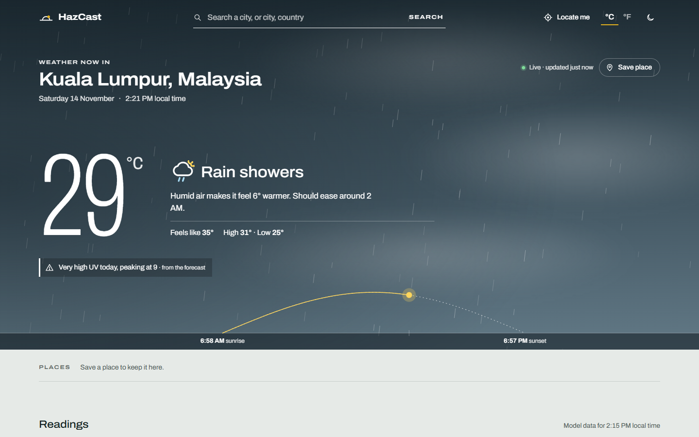

# HazCast - Weather Dashboard

A modern, responsive weather dashboard built with **HTML, CSS and vanilla JavaScript**. HazCast fetches real weather data from the Open-Meteo API, so no API key is needed.

**[🔗 Live Demo](https://hazell-lab.github.io/Haz-Cast/)** · [Case study](https://hazell-lab.github.io/Haz-Cast/case-study.html) · [Source code](https://github.com/hazell-lab/Haz-Cast) · [Portfolio](https://hazimaqil-portfolio.netlify.app)



## Description

HazCast lets you search for any city in the world and see its weather as an atmosphere, not a grid of cards. The top of the page is a sky that changes with the real conditions and the time of day at that place (clear, cloudy, rain, storm, fog, snow, dawn, dusk and night), with a horizon line that shows where the sun is between sunrise and sunset. Under it are the instrument readings, a 24-hour temperature curve, a 7-day range chart, air quality and daylight.

You can save places, revisit recent searches, use your current location, switch between °C and °F, and change between light and dark mode.

## Features

- Live sky: background, motion (rain, snow, drifting fog and cloud) and ink color follow the current weather and time of day
- Horizon line with the sun's real position, sunrise and sunset
- Current weather: temperature, condition, feels like, high/low, local date and time, and a short summary made from the forecast
- Readings: humidity and dew point, wind with direction needle and gusts, pressure with 3-hour trend, visibility, UV now and today's peak, rain today
- Next two hours: rain in 15-minute steps from Open-Meteo's model, labelled as a model estimate, not radar
- Radar map: the past two hours of real radar from RainViewer with a play/pause timeline, loaded only when you open it
- Official alerts from the US National Weather Service for US places, with the full text; elsewhere the page says plainly that it cannot show them
- Next 24 hours: temperature curve with rain chance bars and wind, readable by hover, tap or arrow keys
- Seven days: highs and lows on one shared scale, colored by temperature, with rain chance and amount
- Air quality (US AQI, PM2.5, PM10, ozone, nitrogen dioxide) and pollen where available
- Daylight: the local day as a band, day length and tomorrow's change
- Forecast notes (storms, heavy rain, strong gusts, high UV, unhealthy air), clearly marked as coming from the forecast, not official warnings
- City search with autocomplete (arrow keys work), "city, country" or "city, state" matching, and recent searches when the box is empty
- Use my location (rounded to about 1 km before it is sent or saved)
- Saved places (up to 8) with live temperature and condition, reordered by drag or with Alt + arrow keys, and recent searches (last 5)
- Shareable links: the address always points at the place on screen, and the Share button uses your phone's share sheet or copies the link
- °C and °F (wind, visibility and rain switch to mph, miles and inches too)
- Light and dark mode, refined separately; the sky is the same in both because it is the weather
- Last data for each place is kept, shown straight away and used when offline or rate limited, with a clear "saved" or "live" label
- Installable app with offline support: a service worker keeps the app itself available offline (weather data is never cached by it, so nothing stale is shown as live)
- Weather refreshes every 10 minutes, when you come back to the tab, and when the connection returns
- Respects reduced-motion settings; the sky animation pauses when it is off screen or the tab is hidden
- Responsive layouts for desktop, tablet and mobile, keyboard support and visible focus

## Technologies

- HTML5
- CSS3 (grid, flexbox, custom properties, `color-mix`, media queries)
- JavaScript (vanilla) with inline SVG for icons and charts, and a small canvas layer for rain and snow
- Open-Meteo forecast (including 15-minute data), geocoding and air quality APIs
- RainViewer radar tiles and OpenStreetMap base map, shown with Leaflet 1.9.4 (loaded on demand with integrity hashes)
- US National Weather Service alerts API
- Service worker and web app manifest
- Node's built-in test runner (`node:test`) for the pure logic
- localStorage
- Browser Geolocation API
- Google Fonts (Archivo, using its width axis)

## JavaScript Concepts Demonstrated

- `fetch` and the Fetch API
- `async` / `await`
- `try` / `catch` / `finally` and `response.ok` for error handling
- API integration and working with JSON
- DOM manipulation with template literals
- Event handling (click, submit, input, keydown) and event delegation
- `localStorage` for favorites, recent searches, unit and theme
- Arrays and objects, with `map`, `filter`, `find`-style methods (`some`, `findIndex`) and `slice`
- `Promise.all` to load several requests at once
- Geolocation API with success and error callbacks
- `Intl`-style date formatting with `toLocaleDateString` and `toLocaleTimeString`
- Escaping text before using `innerHTML`, so city names from the API cannot inject HTML
- Ignoring out-of-date responses when the user switches cities quickly

## Folder Structure

```
Haz-Cast/
├── index.html
├── css/
│   └── style.css
├── case-study.html      # case study page
├── manifest.webmanifest # install details
├── sw.js                # offline support for the app files
├── package.json         # only for `npm test`, no dependencies
├── css/
│   ├── style.css
│   └── case-study.css
├── js/
│   ├── weather-core.js  # pure helpers, shared with the tests
│   └── script.js
├── tests/
│   └── core.test.js
├── assets/
│   └── icons/           # favicon and app icons
├── docs/
│   ├── design-audit.md
│   ├── screenshot.png
│   ├── case-study/      # images for the case study page
│   └── screenshots/
└── README.md
```

## Setup

1. Clone this repository (or download it as a ZIP):
   ```bash
   git clone https://github.com/hazell-lab/Haz-Cast.git
   ```
2. Open the `Haz-Cast` folder in VS Code.
3. Install the **Live Server** extension if you do not have it.
4. Right-click `index.html` and choose **Open with Live Server**.
5. The app opens in your browser at an address like `http://127.0.0.1:5500`.

Geolocation, the share link and offline support only work on `localhost`, `127.0.0.1` or `https`, so use Live Server instead of double-clicking the file.

## Tests

The pure logic (unit conversion, weather codes, the rain nowcast, share links, reordering, alert coverage) lives in `js/weather-core.js` and is tested with Node's built-in test runner. Node 18 or newer, no install step:

```bash
npm test
```

## Lighthouse

Measured locally with Lighthouse 12 on 24 November 2026 (python `http.server`, so no compression; live API data):

| | Performance | Accessibility | Best practices | SEO |
| --- | --- | --- | --- | --- |
| App, desktop | 98 | 100 | 100 | 100 |
| App, mobile | 85–89 | 100 | 100 | 100 |
| Case study, mobile | 99 | 100 | 100 | 100 |

On mobile the largest paint is the temperature, which waits for the live forecast over a throttled connection, so the score moves with Open-Meteo's response time.

## API Setup

No API key is required.

- Weather, city search and air quality: [Open-Meteo](https://open-meteo.com/) (free for non-commercial use)
- Radar: [RainViewer](https://www.rainviewer.com/api.html) public API (no key, attribution shown on the map)
- Map: [OpenStreetMap](https://www.openstreetmap.org/copyright) standard tiles (attribution shown on the map)
- Alerts: [US National Weather Service](https://www.weather.gov/documentation/services-web-api) (no key, US only)
- Place name for "use my location": BigDataCloud free client-side reverse geocoding (no key needed). If it fails, the app shows "Your location" instead.

## Data limits

- Official alerts only come from the US National Weather Service, so they only appear for US places. Everywhere else HazCast says it cannot show them. The forecast notes are worked out from the forecast and say so.
- Radar is the past two hours only. RainViewer does not offer a radar forecast, and its tiles stop at zoom 7, so zooming further in shows enlarged tiles. Radar coverage varies by country.
- Rain in the next two hours is Open-Meteo model data in 15-minute steps. It is native in Central Europe and North America and filled in from hourly data elsewhere.
- Air quality is modelled (CAMS), not measured by a local sensor. Pollen is only available for Europe.

## Future Improvements

- Official alerts for more countries (each needs its own source)
- A radar forecast, if a free keyless source becomes available
- Unit settings for wind and pressure separately from temperature
- Backend with user accounts
- React version of the app

## Author

Built by **Hazim Aqil**, Software Engineering student at the German-Malaysian Institute (GMI).

- Portfolio: [hazimaqil-portfolio.netlify.app](https://hazimaqil-portfolio.netlify.app)
- GitHub: [@hazell-lab](https://github.com/hazell-lab)
- LinkedIn: [mdhazimaqil](https://www.linkedin.com/in/mdhazimaqil/)
